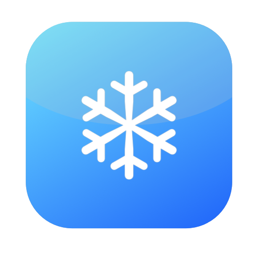
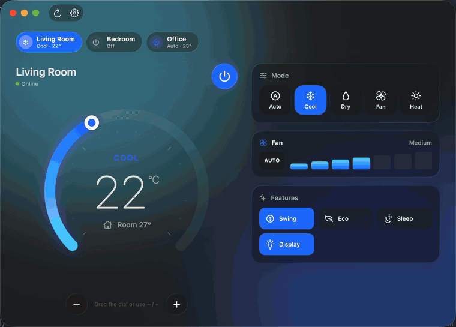
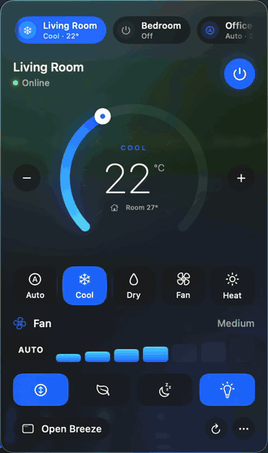
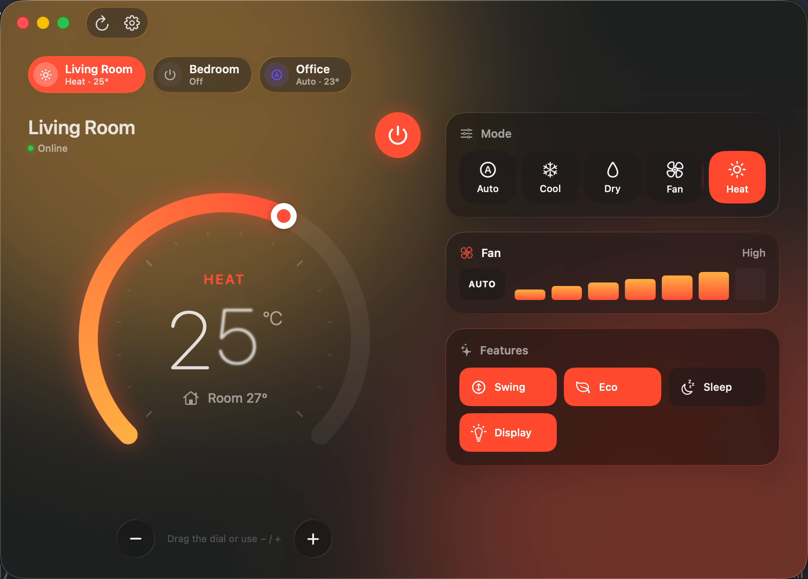
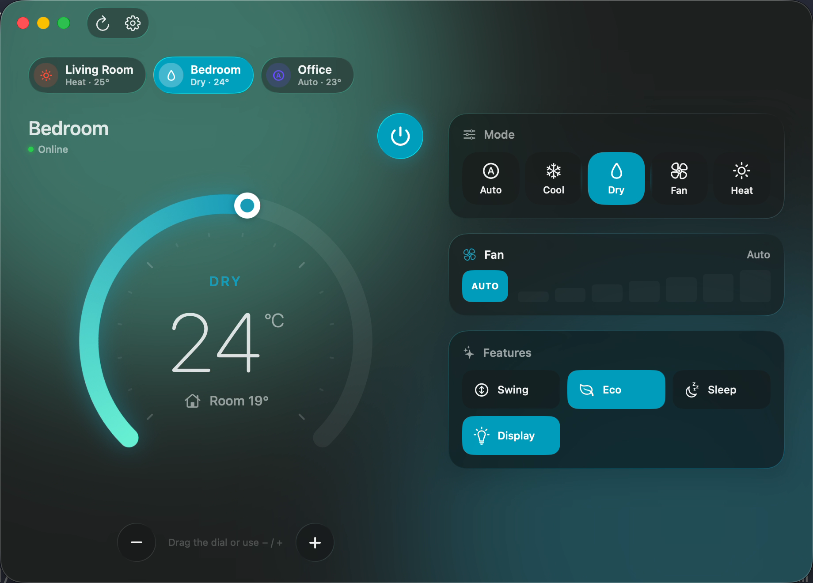

<p align="center">
  
</p>

<h1 align="center">Breeze</h1>

<p align="center">
  Control your TCL air conditioners from your Mac: a desktop app and a menu bar panel, built with SwiftUI and Liquid Glass.
</p>

<p align="center">
  
  <br>
  <sub>Recorded in demo mode with sample data · <a href="docs/media/window.mp4">full-quality video</a></sub>
</p>

> **Unofficial.** Breeze uses the same cloud account as the TCL Home phone app, through TCL's private API
> (reverse-engineered by [nemesa/ha-tcl-home-unofficial-integration](https://github.com/nemesa/ha-tcl-home-unofficial-integration)).
> Breeze is not affiliated with or endorsed by TCL, and TCL may change the API at any time.

## Features

- **Desktop window and menu bar panel** that share the same live state.
- **Temperature dial.** Drag the ring, or use − / +. The app sends one command when you stop.
- **Modes:** Auto, Cool, Dry, Fan and Heat. The UI color follows the mode.
- **Fan speed** from Auto through Mute, Low, Medium and High to Turbo, depending on the model.
- **Extras** your unit supports: Swing, Eco, Sleep, Display and Beep.
- **Multiple ACs.** Switch between rooms instantly. Each chip shows that unit's live mode and temperature.
- **Settings:** open at login, refresh interval, and showing the temperature in the menu bar.
- Native macOS behavior: responsive window, ⌘R to refresh, and VoiceOver support.

<table>
  <tr>
    <td align="center"><br>
        <sub>Menu bar panel · <a href="docs/media/menubar.mp4">video</a></sub></td>
    <td><br><br>
        </td>
  </tr>
</table>

## Installation

Breeze isn't distributed as a signed download yet, so you build it from source. It takes about a minute.

### Requirements

- **macOS 26 (Tahoe) or later**
- **Xcode 26 or later**, installed from the [App Store](https://apps.apple.com/app/xcode/id497799835). The Command Line Tools alone aren't enough, because SwiftUI's macros ship only with Xcode.
- A **TCL Home account with an email and password.** See [Signed in with Google or Apple?](#signed-in-with-google-or-apple) if you don't have a password.

### Build and install

```sh
# 1. One-time: accept the Xcode license if you haven't opened Xcode before
sudo xcodebuild -license accept

# 2. Get the code
git clone https://github.com/pavlospt/breeze.git
cd breeze

# 3. Build Breeze.app and install it into ~/Applications
scripts/build-app.sh

# 4. Launch it
open ~/Applications/Breeze.app
```

Sign in with your TCL Home email and password. Your ACs appear in the window and under the
air-conditioner icon in the menu bar.
To have Breeze start with your Mac, open **Settings** (⌘,) and turn on **Open Breeze at login**.

### Try it without an account

```sh
open ~/Applications/Breeze.app --args --demo
```

Demo mode uses three sample units, so you can explore the UI without signing in. Use `--demo-tour` instead for a hands-free walkthrough.

### Update

```sh
cd breeze && git pull && scripts/build-app.sh
```

### Uninstall

```sh
osascript -e 'quit app "Breeze"'
rm -rf ~/Applications/Breeze.app
security delete-generic-password -s com.ptournaris.Breeze   # saved sign-in
defaults delete com.ptournaris.Breeze                       # preferences
```

## Signed in with Google or Apple?

Breeze can only sign in with an email and password. If you normally use **Sign in with Google** or **Sign in with Apple** in TCL Home, use one of these options:

1. **Set a password on your existing account.** In the TCL Home app, sign out, tap **Forgot password**, and enter the email address of your Google or Apple account. Follow the code you receive to set a password. Google or Apple sign-in on your phone keeps working.
2. **Use a second account.** Create a new TCL Home account with email and password. In the TCL Home app, open your AC, go to **Settings › Share device**, and share it with the new account.

## Supported devices

Breeze maps controls for the TCL device types the community integration documents:

| Type | Modes | Fan speeds |
|---|---|---|
| Split AC (incl. Fresh Air, Cylindrical, Duct) | Auto, Cool, Dry, Fan, Heat | Auto, Mute, Low → High, Turbo |
| Window AC | Auto, Cool, Dry, Fan | Auto, Low, Medium, High |
| Portable AC | Cool, Dry, Fan (+ Auto on models with swing) | Low, High (+ Auto) |

Extras (Swing, Eco, Sleep, Display, Beep) appear only when your unit reports them. Temperatures are in °C.

## Troubleshooting

- **"Sign-in failed"**: check your email and password in the TCL Home app first. Accounts that only use Google or Apple sign-in need a password; see [above](#signed-in-with-google-or-apple).
- **Errors mentioning HTTP 401/403**: Breeze signs in again automatically. If the errors persist, sign out and back in from Settings › Account.
- **The AC shows Offline**: the unit itself is disconnected from TCL's cloud. Check it in the TCL Home app.
- **Logs**: open Console.app and filter by the subsystem `com.ptournaris.Breeze`.

## Privacy

Your credentials are stored only in your login Keychain. Breeze talks only to TCL's account and cloud endpoints and to the AWS endpoints TCL uses for device control. It has no analytics or third-party services.

## Development

```sh
open Package.swift            # work in Xcode, with SwiftUI previews
swift test                    # Swift Testing suite (needs Xcode's toolchain)
scripts/record-demo.sh        # regenerate the README media from the demo tour
```

### Architecture

```
Sources/
  BreezeKit/                  UI-free library: models, networking, persistence
    Models/                   ACDevice, ACState (typed shadow state), ACMode, DeviceProfile
    Networking/               TCLCloudClient (actor), SigV4Signer
    Services/                 ACService protocol, CredentialStore (Keychain)
    Support/                  JSONValue, hashing/JWT helpers, os.Logger categories
  Breeze/                     SwiftUI app
    App/                      BreezeApp: Window + MenuBarExtra + Settings scenes
    Model/                    ACController (@Observable, @MainActor), LaunchAtLogin (SMAppService)
    Views/                    Window/, MenuBar/, Settings/, Shared/, Components/
    Theme/                    Mode palette, ambient background, glass helpers
    Demo/                     Demo backend + scripted tour (--demo, --demo-tour)
    Preview/                  SwiftUI previews
Tests/BreezeKitTests/         Swift Testing: SigV4 (reference vector), profiles, parsing, JWT
Support/                      Info.plist, AppIcon.icns
scripts/                      build-app.sh, record-demo.sh, make-icon.swift
```

**Data flow:** Views read `ACController` from the environment. The controller owns an `any ACService`: `TCLCloudClient` normally, or `DemoACService` in demo mode and previews. It keeps a cached `ACState` per device and applies commands optimistically. It then confirms each command by reading the device state back.

**Cloud session:** account login → regional URLs → SaaS and Cognito tokens → temporary AWS credentials → AWS IoT device shadow, read via REST and written via MQTT-over-REST publish. The session is cached in the client actor and rebuilt automatically when it expires or is rejected.

**Concurrency:** Swift 6 language mode with strict checking. Networking is isolated in an actor, and UI state lives on the main actor.

## License

[MIT](LICENSE)
